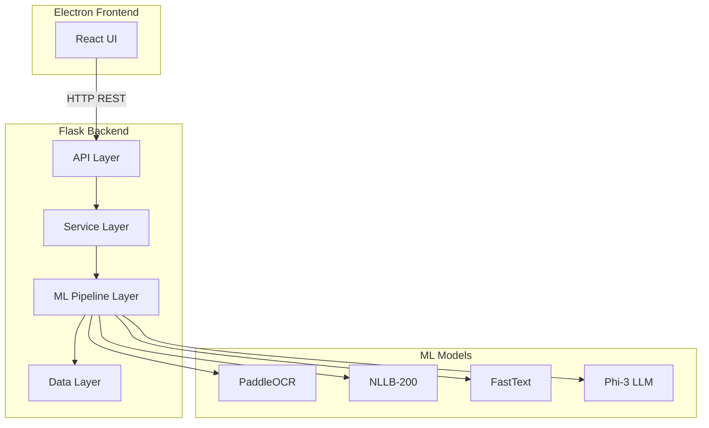
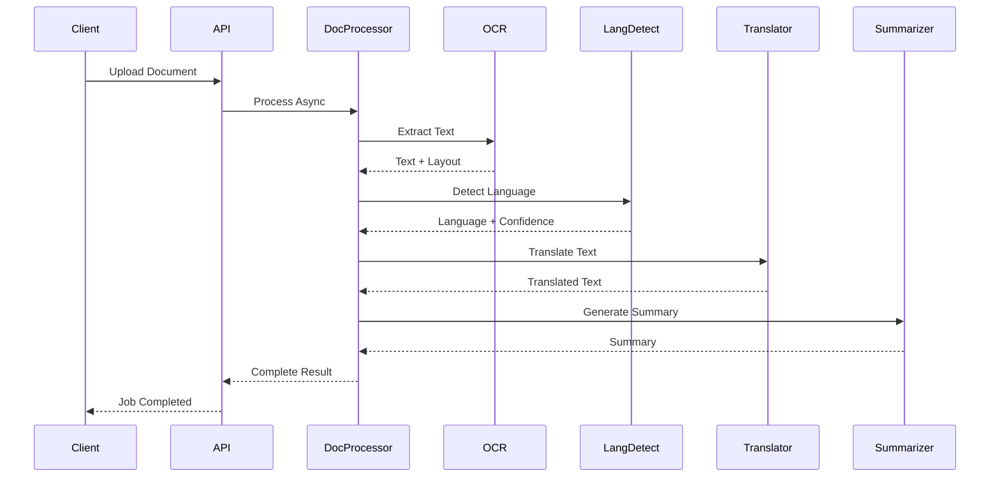
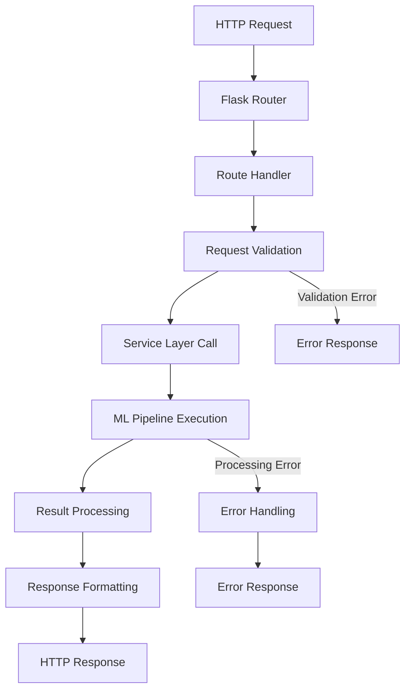
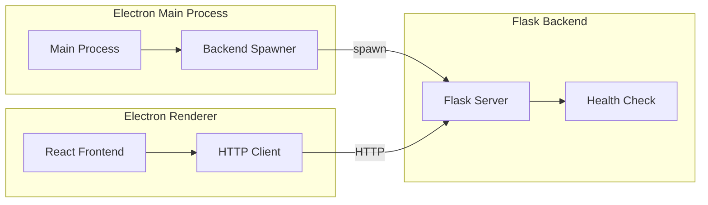
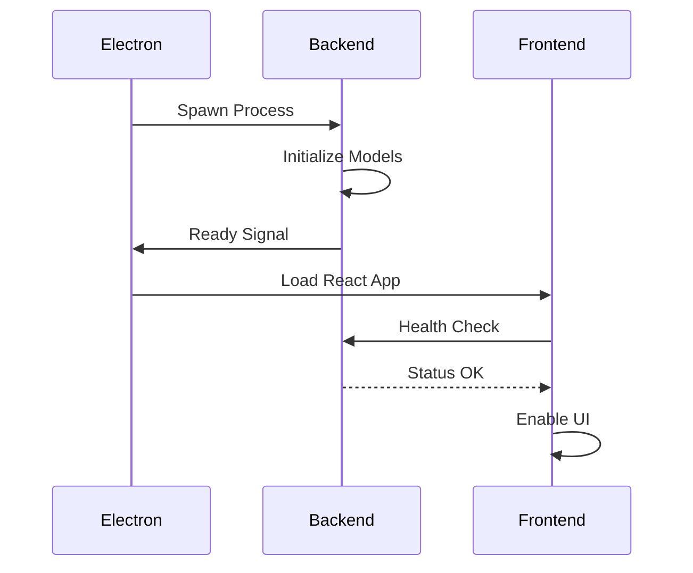
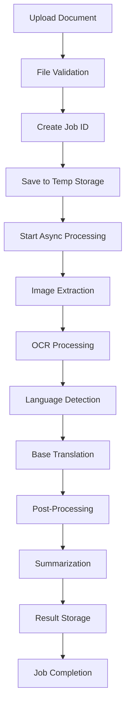

# Backend Architecture — Offline Nepali & Sinhala Literature Translator

**Version:** 2.0  
**Author:** Sahas + Team  
**Date:** 2025-01-21  
**Python Version:** 3.13  
**Framework:** Flask

---

## Abstract

This document describes the complete backend architecture for an offline Nepali & Sinhala literature translation system. The architecture implements a layered Flask-based backend with comprehensive logging, modular ML pipeline design, and offline-first operation. The system follows SIH (Smart India Hackathon) submission requirements and IEEE documentation standards for technical clarity and reproducibility.

## Table of Contents

1. [Introduction](#1-introduction)
2. [Problem Statement](#2-problem-statement)
3. [System Architecture Overview](#3-system-architecture-overview)
4. [Layered Architecture Design](#4-layered-architecture-design)
5. [Component Specifications](#5-component-specifications)
6. [ML Pipeline Architecture](#6-ml-pipeline-architecture)
7. [Logging System Architecture](#7-logging-system-architecture)
8. [Request/Response Lifecycle](#8-requestresponse-lifecycle)
9. [Offline Mode Architecture](#9-offline-mode-architecture)
10. [Electron + Flask Integration](#10-electron--flask-integration)
11. [Data Flow Diagrams](#11-data-flow-diagrams)
12. [API Architecture](#12-api-architecture)
13. [Security Architecture](#13-security-architecture)
14. [Performance Architecture](#14-performance-architecture)
15. [Deployment Architecture](#15-deployment-architecture)
16. [Testing Architecture](#16-testing-architecture)
17. [Compliance & Standards](#17-compliance--standards)

---

## 1. Introduction

This architecture document provides a comprehensive technical specification for the Flask-based backend system that powers the offline Nepali & Sinhala literature translator. The system is designed with modularity, scalability, and offline operation as core principles, implementing industry-standard patterns for ML model management, request processing, and system monitoring.

## 2. Problem Statement

**Challenge:** Existing translation systems fail to preserve literary nuances, cultural idioms, and poetic structures when translating Nepali and Sinhala literature to English. Additionally, most systems require internet connectivity, limiting accessibility in regions with poor connectivity.

**Solution:** Design a comprehensive offline backend that combines OCR, language detection, neural translation, and post-processing to deliver high-quality literary translations while maintaining complete data privacy through local processing.

## 3. System Architecture Overview



### Architecture Principles

1. **Separation of Concerns**: Clear separation between API, business logic, and ML processing
2. **Offline-First**: All processing happens locally without external dependencies
3. **Modular Design**: Each component can be developed, tested, and deployed independently
4. **Scalable Logging**: Comprehensive logging system for monitoring and debugging
5. **Error Resilience**: Graceful error handling and recovery mechanisms

## 4. Layered Architecture Design

### 4.1 Presentation Layer (API Routes)
- **Purpose**: Handle HTTP requests and responses
- **Components**: Flask blueprints for different functional areas
- **Responsibilities**: Request validation, response formatting, error handling

### 4.2 Service Layer (Business Logic)
- **Purpose**: Implement business rules and orchestrate workflows
- **Components**: Service classes for different domains
- **Responsibilities**: Workflow coordination, data transformation, caching

### 4.3 ML Pipeline Layer (Model Processing)
- **Purpose**: Execute machine learning operations
- **Components**: Model wrappers and processing engines
- **Responsibilities**: Model inference, result post-processing, performance optimization

### 4.4 Data Layer (Storage & Configuration)
- **Purpose**: Manage data persistence and configuration
- **Components**: File system operations, configuration management
- **Responsibilities**: Data storage, retrieval, and configuration management

## 5. Component Specifications

### 5.1 Flask Application Core (`app.py`)

```python
# Core responsibilities:
- Application initialization and configuration
- CORS setup for Electron integration
- Route registration and middleware setup
- Error handling and logging initialization
```

**Key Features:**
- Thread-safe request handling
- Graceful shutdown mechanisms
- Environment-based configuration
- Health monitoring integration

### 5.2 Configuration Management (`utils/config.py`)

```python
# Configuration domains:
- Server settings (host, port, debug mode)
- Model paths and parameters
- Logging configuration
- File handling limits
```

**Design Patterns:**
- Environment variable override support
- Path resolution for cross-platform compatibility
- Runtime directory creation
- Validation of critical settings

### 5.3 Logging System (`utils/logger.py`)

```python
# Logging architecture:
- Rotating file handlers for different log types
- Console output for development
- Structured logging with metadata
- Performance monitoring integration
```

**Log Categories:**
- **app.log**: General application events
- **error.log**: Errors and warnings only
- **model.log**: ML model specific events

### 5.4 Route Handlers (`routes/`)

#### Health Routes (`routes/health.py`)
- System health monitoring
- Model status verification
- Version information
- Readiness checks for Electron

#### Upload Routes (`routes/upload.py`)
- File upload handling
- Job management and tracking
- Asynchronous processing coordination
- Result retrieval

#### Translation Routes (`routes/translation.py`)
- Direct text translation
- Language detection
- Text summarization
- Batch processing support

### 5.5 Service Layer (`services/`)

#### Model Manager (`services/model_manager.py`)
- Centralized model loading and management
- Model health monitoring
- Resource optimization
- Error recovery mechanisms

#### Document Processor (`services/document_processor.py`)
- End-to-end document processing pipeline
- Asynchronous job management
- Progress tracking and reporting
- Error handling and recovery

#### Translation Service (`services/translation_service.py`)
- Direct translation operations
- Language detection coordination
- Result caching and optimization
- Quality assurance checks

### 5.6 ML Pipeline Components

#### OCR Engine (`ocr/ocr_engine.py`)
- PaddleOCR integration
- Image preprocessing pipeline
- PDF text extraction
- Layout preservation logic

#### Translation Engine (`translation/translator.py`)
- NLLB-200 model integration
- Language code mapping
- Batch translation optimization
- Quality scoring mechanisms

#### Language Detector (`language_detection/detector.py`)
- FastText model integration
- Script analysis for language hints
- Confidence scoring
- Multi-language text handling

#### Summarizer (`summarizer/summarizer.py`)
- Extractive summarization algorithms
- Abstractive summarization (future)
- Length optimization
- Quality preservation

## 6. ML Pipeline Architecture

### 6.1 Pipeline Flow



### 6.2 Model Loading Strategy

1. **Lazy Loading**: Models loaded on first use to reduce startup time
2. **Memory Management**: Intelligent model unloading during low usage
3. **Error Recovery**: Automatic model reloading on failure
4. **Performance Monitoring**: Track inference times and resource usage

### 6.3 Processing Optimization

- **Batch Processing**: Group similar operations for efficiency
- **Caching**: Cache results to avoid reprocessing
- **Parallel Processing**: Use threading for independent operations
- **Resource Pooling**: Reuse model instances across requests

## 7. Logging System Architecture

### 7.1 Logging Hierarchy

```
Root Logger (INFO)
├── Console Handler (INFO)
├── App File Handler (INFO) → app.log
├── Error File Handler (WARNING) → error.log
└── Model Logger (DEBUG) → model.log
    ├── OCR Logger
    ├── Translation Logger
    ├── Language Detection Logger
    └── Summarizer Logger
```

### 7.2 Log Format Standards

```python
# Standard format for all logs:
'%(asctime)s - %(name)s - %(levelname)s - %(funcName)s:%(lineno)d - %(message)s'

# Example output:
2025-01-21 10:30:45,123 - models.ocr - INFO - extract_text:45 - Processing image: document.pdf
```

### 7.3 Rotating File Configuration

- **Max File Size**: 10 MB per log file
- **Backup Count**: 5 backup files retained
- **Rotation Strategy**: Size-based rotation with timestamp preservation
- **Compression**: Automatic compression of old log files

### 7.4 Performance Logging

```python
# Request timing example:
logger.info(f"Request processed in {elapsed_time:.3f}s - Endpoint: {endpoint}")

# Model inference timing:
logger.info(f"OCR completed in {ocr_time:.3f}s - Pages: {page_count}")
```

## 8. Request/Response Lifecycle

### 8.1 Request Processing Flow



### 8.2 Error Handling Strategy

1. **Input Validation**: Validate all inputs at the API layer
2. **Service Errors**: Handle business logic errors gracefully
3. **Model Errors**: Implement fallback mechanisms for model failures
4. **System Errors**: Log and report system-level issues
5. **User Communication**: Provide clear error messages to users

### 8.3 Response Standards

```json
// Success Response Format
{
  "status": "success",
  "data": { /* response data */ },
  "timestamp": "2025-01-21T10:30:45Z",
  "processing_time": 2.345
}

// Error Response Format
{
  "status": "error",
  "error": {
    "code": "VALIDATION_ERROR",
    "message": "Invalid file format",
    "details": { /* error details */ }
  },
  "timestamp": "2025-01-21T10:30:45Z"
}
```

## 9. Offline Mode Architecture

### 9.1 Offline Design Principles

1. **Zero External Dependencies**: No internet required during operation
2. **Local Model Storage**: All models stored and loaded locally
3. **Self-Contained Processing**: Complete pipeline runs locally
4. **Offline Validation**: All validation happens without external calls

### 9.2 Model Distribution Strategy

```
models/
├── paddleocr/          # OCR models (200-400 MB)
│   ├── det_model/
│   ├── rec_model/
│   └── cls_model/
├── nllb/              # Translation models (3-15 GB)
│   └── model.gguf
├── fasttext/          # Language detection (100-200 MB)
│   └── lid.176.bin
└── phi3/              # LLM models (1-8 GB)
    └── model.gguf
```

### 9.3 Offline Validation

- **File Type Validation**: Local MIME type checking
- **Model Integrity**: Checksum validation for model files
- **Resource Availability**: Local resource monitoring
- **Dependency Checking**: Verify all required components are available

## 10. Electron + Flask Integration

### 10.1 Integration Architecture



### 10.2 Process Management

1. **Backend Spawning**: Electron spawns Flask as subprocess
2. **Health Monitoring**: Regular health checks to ensure backend availability
3. **Graceful Shutdown**: Proper cleanup when Electron closes
4. **Error Recovery**: Automatic backend restart on failure

### 10.3 Communication Protocol

- **Transport**: HTTP REST API over localhost
- **Port**: Configurable port (default 5005)
- **Security**: CORS configured for Electron origins
- **Data Format**: JSON for all API communications

### 10.4 Startup Sequence



## 11. Data Flow Diagrams

### 11.1 Document Processing Flow



### 11.2 Real-time Translation Flow


## 12. API Architecture

### 12.1 RESTful Design Principles

- **Resource-Based URLs**: Clear resource identification
- **HTTP Methods**: Proper use of GET, POST, PUT, DELETE
- **Status Codes**: Appropriate HTTP status codes
- **Stateless**: No server-side session state

### 12.2 API Versioning Strategy

```
/api/v1/health          # Version 1 endpoints
/api/v1/translate
/api/v1/upload

/api/v2/health          # Future version support
```

### 12.3 Rate Limiting & Throttling

- **Request Limits**: Prevent resource exhaustion
- **Queue Management**: Handle concurrent requests efficiently
- **Priority Queuing**: Prioritize different request types
- **Resource Monitoring**: Track system resource usage

## 13. Security Architecture

### 13.1 Security Layers

1. **Input Validation**: Sanitize all user inputs
2. **File Security**: Validate file types and sizes
3. **Path Security**: Prevent directory traversal attacks
4. **Process Isolation**: Isolate ML model processes
5. **Data Privacy**: Ensure no data leaves the local system

### 13.2 File Upload Security

```python
# Security measures for file uploads:
- File type validation (whitelist approach)
- File size limits (configurable)
- Filename sanitization
- Temporary file cleanup
- Virus scanning (optional)
```

### 13.3 Local Data Protection

- **Temporary File Cleanup**: Automatic cleanup of processed files
- **Secure File Paths**: Prevent path traversal vulnerabilities
- **Permission Management**: Appropriate file system permissions
- **Data Encryption**: Optional encryption for sensitive data

## 14. Performance Architecture

### 14.1 Performance Optimization Strategies

1. **Model Optimization**: Use quantized models for faster inference
2. **Caching**: Cache frequently accessed data and results
3. **Parallel Processing**: Utilize multiple CPU cores
4. **Memory Management**: Efficient memory usage and cleanup
5. **I/O Optimization**: Optimize file operations and disk access

### 14.2 Resource Monitoring

```python
# Performance metrics tracked:
- Request processing time
- Model inference time
- Memory usage per request
- CPU utilization
- Disk I/O statistics
```

### 14.3 Scalability Considerations

- **Horizontal Scaling**: Support for multiple backend instances
- **Load Balancing**: Distribute requests across instances
- **Resource Pooling**: Efficient resource utilization
- **Queue Management**: Handle high-volume requests

## 15. Deployment Architecture

### 15.1 PyInstaller Packaging

```bash
# Build configuration for standalone executable:
pyinstaller app.py --onefile \
  --add-data "models;models" \
  --add-data "logs;logs" \
  --hidden-import=paddleocr \
  --hidden-import=transformers \
  --console
```

### 15.2 Distribution Strategy

1. **Single Executable**: Self-contained executable with all dependencies
2. **Model Bundling**: Include all required models in distribution
3. **Configuration**: Environment-based configuration for different deployments
4. **Updates**: Support for model and application updates

### 15.3 Cross-Platform Support

- **Windows**: Native executable with Windows-specific optimizations
- **macOS**: Universal binary supporting Intel and Apple Silicon
- **Linux**: AppImage or native binary for different distributions

## 16. Testing Architecture

### 16.1 Testing Strategy

```
tests/
├── unit/              # Unit tests for individual components
├── integration/       # Integration tests for API endpoints
├── performance/       # Performance and load tests
├── e2e/              # End-to-end workflow tests
└── fixtures/         # Test data and mock objects
```

### 16.2 Test Categories

1. **Unit Tests**: Test individual functions and classes
2. **Integration Tests**: Test component interactions
3. **API Tests**: Test all API endpoints
4. **Performance Tests**: Measure system performance
5. **Security Tests**: Validate security measures

### 16.3 Continuous Testing

- **Automated Testing**: Run tests on every code change
- **Coverage Reporting**: Maintain high test coverage
- **Performance Regression**: Detect performance degradation
- **Security Scanning**: Regular security vulnerability scans

## 17. Compliance & Standards

### 17.1 SIH Compliance

- **Problem Statement**: Clear definition of problem and solution
- **Technical Documentation**: Comprehensive technical specifications
- **Reproducible Build**: Detailed build and deployment instructions
- **Testing Evidence**: Comprehensive testing and validation results
- **Ethical Considerations**: Privacy and copyright compliance

### 17.2 IEEE Standards Compliance

- **Documentation Structure**: Follow IEEE documentation standards
- **Technical Specifications**: Detailed technical requirements
- **Architecture Diagrams**: Standard notation and formatting
- **Testing Methodology**: IEEE-compliant testing procedures

### 17.3 Code Quality Standards

- **PEP 8**: Python code style compliance
- **Type Hints**: Use type annotations for better code clarity
- **Documentation**: Comprehensive docstrings and comments
- **Error Handling**: Consistent error handling patterns
- **Logging Standards**: Structured and consistent logging

---

## Conclusion

This architecture provides a robust, scalable, and maintainable foundation for the offline Nepali & Sinhala literature translator backend. The layered design ensures separation of concerns, while the comprehensive logging and monitoring systems provide visibility into system operation. The offline-first approach ensures data privacy and accessibility, while the modular design allows for easy maintenance and future enhancements.

The architecture follows industry best practices and standards, ensuring reliability, security, and performance while meeting the specific requirements of the SIH project and IEEE documentation standards.

---

**References:**

[1] Flask Documentation, "Application Structure," Flask Team, 2024.  
[2] Python Software Foundation, "PEP 8 -- Style Guide for Python Code," 2001.  
[3] IEEE Standards Association, "IEEE Std 1016-2009 - IEEE Standard for Information Technology," 2009.  
[4] Electron Documentation, "Process Model," GitHub Inc., 2024.  
[5] PyInstaller Documentation, "Using PyInstaller," PyInstaller Development Team, 2024.